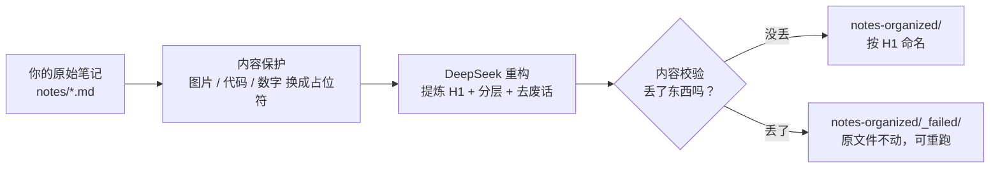

# MdOrganizer · 笔记智能重构工具

> 基于 DeepSeek 的 Markdown 笔记智能重构工具。把杂乱无章的笔记，一键整理成排版精美、层级分明、可以直接放进知识库的成品，。

---

## 这是什么

你电脑里大概躺着很多这样的笔记：

```markdown
今天学了redis的持久化我觉得挺重要的然后呢RDB是快照AOF是日志
我在想这两个到底怎么选老师说要结合业务场景
```

**没有标题、排版是一坨、全是口语废话**——存下来的时候觉得有用，回头再看根本不想读。

MdOrganizer 要解决的就是这件事：你只管把原始笔记丢进去，它负责整理成下面这样：

```markdown
# Redis 持久化机制笔记

## 一、RDB 与 AOF 的区别

RDB 是快照式持久化，AOF 是追加日志式持久化，两者的取舍取决于业务对数据丢失的容忍度。

## 二、怎么选

- 允许丢失几分钟数据、追求恢复速度 → RDB
- 数据不能丢、能接受更大的文件 → AOF
```

具体做了什么：

| 你原来的笔记 | 整理之后 |
|---|---|
| 没有标题，或者标题一堆 `##` | 自动读完全文，**提炼一个 H1 标题，并直接用这个标题当文件名** |
| 文件名是 `test.md`、`day2.md`、`新建文档.md` | 变成 `Redis 持久化机制笔记.md`，一眼知道里面是什么 |
| 一段话几百字没有分段 | 按逻辑分层，补 H2 / H3 |
| “我觉得”“然后呢”“希望这对你有帮助” | 清洗掉，改成陈述句 |
| 图片、代码、数字、参数名 | **一个都不能少**，少一个就判定失败并拦下来 |

**核心定位：无损结构化重构，不是摘要。** 不删干货、不丢代码、不改图片路径，只做「清洗 + 分层 + 排版」。



---

## 核心功能

- **无损内容提取**：发送给 AI 之前，先把代码块、行内代码、图片链接替换成占位符；AI 返回后再回填。图片路径、代码内容一个字符都不会变。
- **强制 H1 提炼命名**：整理结果必须有 H1。AI 漏了就自动追加严厉提示重试；重试两次仍然没有，判定失败、绝不拿原文件名凑数。
- **哈希指纹防文件名抖动**：`temperature` 已设为 `0`，但模型仍可能给出同义词标题。所以只要源文件内容一字未改，就沿用上次的文件名（内容 sha256 记在 `.history.json` 里），文件名不会来回跳。
- **重名不覆盖**：同一篇笔记反复跑，直接覆盖上一次的结果；只有**不同源文件**撞了同一个标题，才追加 `_1`、`_2`。
- **失败文件安全隔离**：真的丢了内容，就放进 `_failed/`（同样按标题命名，一眼看出是哪篇），**原文件永远不被改动**。
- **软性提示（💡）**：字数缩水、列表化过多、人称没洗干净这类“表达上的取舍”，只在终端说一声 `💡 贴心提示`，**笔记照常生成**，不拦截、不打扰。

---

## 开箱测试（强烈推荐）

**不用写新笔记，仓库里已经给你准备好了 6 篇测试用例**，就在 [`notes/`](./notes) 文件夹：

| 文件 | 用来测什么 | 预期结果 |
|---|---|---|
| `test-normal.md` | 排版正常的普通笔记 | 原样保留结构，几乎无提示 |
| `test-no-h1.md` | **完全没有标题**的一整段纯文本 | AI 读完全文自己提炼 H1 并用于命名，例如 → `数据泄漏与预处理 Pipeline.md` |
| `test-tips-word.md` | 大量口语废话 | 触发 `💡 字数缩水` 提示，笔记照常生成 |
| `test-tips-list.md` | 一长段连贯的技术解释 | 测列表化处理 |
| `test-tips-pronoun.md` | 满篇“我认为 / 我们来看” | 测人称清洗 |
| `test-fail-img.md` | 带 Markdown 图片链接 | 测图片占位符保护，路径一字不改 |

配置好 API Key 之后，直接跑：

```bash
python main.py --dir "notes"
```

**你会看到什么**

1. 终端逐篇打印进度，并出现类似这样的提示——这**不是错误**：

   ```
   【贴心提示（不影响使用，笔记已正常生成）】
     💡 整理后的字数比原文少了一些（约为原文的 57%）。这通常是 AI 删掉了废话，但也请留意有没有丢失重要内容。
   ```

2. 跑完给出汇总：`本次共处理 15 篇，✅成功 15 篇，❌失败 0 篇。`
3. 打开 `notes-organized/`，文件名已经变成 AI 提炼的标题，例如 `test-tips-word.md` → `Redis 持久化机制笔记.md`、`test-no-h1.md` → `数据泄漏与预处理 Pipeline.md`；而 `notes/` 里的原文件一个字都没变。

> 想验证“失败长什么样”？把一篇带图片的笔记里的图片路径改坏再跑，或临时改 `prompts/system-prompt.md` 让它删图片，就会看到红色 ❌，文件落入 `notes-organized/_failed/`。正常情况下图片有占位符保护，不会丢。

> 提示：`notes/` 里既放你的真实笔记，也放着这 6 篇测试用例。仓库要公开的话，记得先把真实笔记挪走。

---

## 安装与环境配置

### 1. 环境要求

- Python 3.9 或更高版本
- 依赖：`requests`、`python-dotenv`
- 一个 DeepSeek API Key（[申请地址](https://platform.deepseek.com/)）

### 2. 安装依赖

```bash
python -m venv .venv

# Windows
.venv\Scripts\python -m pip install -r requirements.txt

# macOS / Linux
source .venv/bin/activate && pip install -r requirements.txt
```

> Windows 上激活虚拟环境后如果 `python` 仍指向系统解释器，直接用 `.venv\Scripts\python main.py ...` 就行。

### 3. 配置 `.env`

复制 [`.env.example`](./.env.example) 为 `.env`，填入你的密钥：

```ini
DEEPSEEK_BASE_URL=https://api.deepseek.com
DEEPSEEK_MODEL=deepseek-flash
DEEPSEEK_API_KEY=sk-你的密钥
```

`.env` 已在 [`.gitignore`](./.gitignore) 中，不会被提交到 GitHub。

---

## 怎么运行

```bash
# 单篇：整理一篇笔记
python main.py --file "notes/我的笔记.md"

# 批量：整理整个文件夹（只处理该文件夹第一层的 .md）
python main.py --dir "notes"
```

- `--file` 和 `--dir` 二选一，必填。
- 原文件**只读不写**，结果统一输出到 `notes-organized/`。
- 单篇失败不会中断批量任务，其余笔记照常处理。

---

## Windows 一键脚本（推荐给不想敲命令的人）

项目根目录有个 [`一键整理.bat`](./一键整理.bat)，双击它就等于执行 `python main.py --dir "notes"`。

**它做了什么**

1. `cd /d "%~dp0"` 自动切到自己所在的目录，所以快捷方式放哪都不会出错；
2. 用项目里的虚拟环境解释器 `.venv\Scripts\python.exe` 跑批量整理 `notes` 文件夹；
3. 跑完打印「任务执行完毕，按任意键关闭窗口...」，窗口停住，**不会一闪而过**，方便你看结果。

**怎么放到桌面**

1. 在文件资源管理器里找到 `一键整理.bat`；
2. **右键**它 →「发送到」→「桌面快捷方式」；
3. 以后把要整理的笔记丢进 `notes/`，双击桌面这个快捷方式就行。
4. （可选）更换自定义图标：
      - 在桌面找到刚刚生成的快捷方式，右键 →「属性」。
      - 点击「更改图标...」→ 点击「浏览...」，选中项目文件夹里的 `icon.ico` 文件。

> 双击后它会自动读取 `notes` 文件夹，逐篇打印进度和提示，处理完后窗口暂停等你按任意键。
> 想整理别的文件夹，用记事本把 `.bat` 里的 `--dir "notes"` 改成你的路径即可。

---

## 整理结果放在哪

| 路径 | 说明 |
|---|---|
| `notes-organized/` | 整理成功的笔记，文件名 = 正文第一行的 H1 标题 |
| `notes-organized/_failed/` | 真的丢了内容的笔记（同样按标题命名，方便识别是哪篇） |
| `notes-organized/.history.json` | 源文件 → 输出文件名 + 内容 sha256 的映射，用来保证文件名稳定、不重复堆积 |

文件名规则：

- 标题里的 Windows 非法字符 `\ / : * ? " < > |` 自动替换成 `_`，过长截断到 50 字；
- **同一篇笔记重复运行 = 覆盖上一次的产物**，不会攒出 `_1`、`_2`；
- 只有不同源文件撞了同一个标题，才追加 `_1`、`_2`，绝不覆盖别人的文件；
- 从 `_failed` 修复后重跑成功，`_failed` 里的旧副本会被自动清掉。

---

## 常见提示（💡）说明

跑完之后终端偶尔会出现 `💡 贴心提示`。**它不影响结果：笔记已经正常生成，可以直接使用**，只是 AI 在某些地方做了表达上的取舍，工具如实告诉你一声。

| 提示内容 | 实际含义 | 想调整怎么办 |
|---|---|---|
| 字数比原文少了一些 | AI 判定那部分是废话，删掉了 | 觉得删过头了，可把 [prompts/system-prompt.md](./prompts/system-prompt.md) 里「允许删减的范围」写得更严 |
| 把长段落拆成了列表 | AI 觉得列表更好读，但破坏了原文的段落连贯性 | 在系统提示词里加一句“禁止把段落改成列表” |
| 文中还留着“我 / 我们” | 个别句子的人称没洗干净 | 手动改一下即可；也可在系统提示词的「人称清洗」里补充你常出现的写法 |
| 一级标题个数变了 | AI 多写了 `#`，或把正文里的 `#` 降成了 `##`；内容一个字都没少 | 手动改一下 `#` 的数量即可 |
| 关键词覆盖率偏低 / 术语被换成同义说法 | AI 换了说法，写法变了但意思没变 | 把重要术语写进 [glossary.md](./glossary.md)，下次会被强制保留 |

这些提示只写进终端报告，**不参与任何判定**，笔记永远都会正常落盘。

---

## 什么情况才会进 `_failed`

只有 AI **真的丢了东西**才会拦截，就这 5 条：

1. 图片比原文少了；
2. 代码块比原文少了；
3. 行内代码（反引号里的内容）被改坏或删掉；
4. 数字 + 单位丢失（如 `300 秒` 变成 `300`）；
5. 参数名丢失（如 `api_key`、`lr_scheduler`）。

再加上第 6 条兜底：重试两次后依然生成不出 H1 标题。

注意「**多了不算丢**」：AI 主动把一段纯文本包成代码块、多写一级标题、把 `#` 降成 `##`，都不会判失败，只会在提示里说一声——因为内容没丢，你拿到的东西是完整的。

---

## 生成的笔记长什么样

每篇输出都是同一个模子出来的，可以直接放进知识库：

```markdown
# 模型辅助标注的核心流程

（开篇一段话，说明这篇笔记在讲什么，由原文归纳，不编造）

## 一、为什么要做模型辅助标注

段落式说明，保留原文的推导与细节，不压缩成一句话。

## 二、具体步骤

1. 第一步……
2. 第二步……

> 原文里的引用、注意点保持在引用块里。


```

| 项目 | 规则 |
|---|---|
| 文件名 | 取自 H1 标题，非法字符换 `_`，最长 50 字 |
| H1 | 至少一个，固定在第一行；原文没有也会根据全文生成 |
| H2 / H3 | 按原文逻辑分层，不跳级 |
| 正文形态 | 以段落为主，只有真正的并列项（步骤、参数清单）才用列表 |
| 图片 | 一张不少、路径一个字符都不改 |
| 代码块 / 行内代码 | 一块不少、内容原封不动 |
| 数字与单位 | `300 秒`、`30 天` 原样保留 |
| 参数名 | `api_key`、`backup_dir` 原样保留 |
| 术语 | 按 [glossary.md](./glossary.md) 统一，登记的写法强制保留 |
| 人称 | 删掉“我 / 我们 / 你”这类对话口气，改成陈述句 |
| 废话 | 只删“希望这对你有帮助”这类纯废话，带知识点的句子一律保留 |

---

## 目录结构

```
.
├── main.py                    # 入口：单篇 / 批量、校验、重命名、写盘
├── 一键整理.bat               # 双击即批量整理 notes/
├── prompts/
│   └── system-prompt.md       # 发给 DeepSeek 的系统提示词（决定整理风格）
├── glossary.md                # 术语表（可自行增删）
├── notes/                     # 你的原始笔记 + 6 篇开箱测试用例
├── notes-organized/           # 整理结果（首次运行后自动生成）
├── requirements.txt
├── .env.example               # 配置模板
├── REQUIREMENTS.md            # 需求与校验规则
└── README.md
```

---

## 想定制整理风格？

- **改文风 / 改结构**：编辑 [`prompts/system-prompt.md`](./prompts/system-prompt.md)，这是唯一影响 AI 输出的地方。
- **改术语统一规则**：编辑 [`glossary.md`](./glossary.md)，一行一个术语。
- **改校验严格度**：`main.py` 里的 `validate()`，硬性规则和 💡 提示都在这里，注释清楚。
- **完整需求与判定规则**：[REQUIREMENTS.md](./REQUIREMENTS.md)

## 已知限制

- 只处理单个文件夹**第一层**的 `.md`，不会递归子目录。
- 整理质量取决于所选模型；默认 `deepseek-flash`，追求质量可把 `.env` 里的 `DEEPSEEK_MODEL` 换成更强的模型。
- 超长笔记（数万字）单次输出可能被模型截断，建议先拆分再整理。
